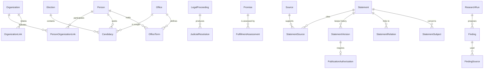

# Modelo de dominio

Modelo conceptual de CANDIDATON. La tarea 003, del 8 de noviembre de 2026, lo aprobó con condiciones. Esas condiciones ya están escritas aquí, en la política editorial y en el flujo de verificación. La aprobación no crea tablas ni cambia la interfaz.

Las reglas de producto ya confirmadas están en [DECISIONS.md](./DECISIONS.md). La política de publicación está en [EDITORIAL_POLICY.md](./EDITORIAL_POLICY.md). El circuito de revisión y la trazabilidad están en [VERIFICATION_WORKFLOW.md](./VERIFICATION_WORKFLOW.md).

Los nombres en español son los del producto. El código estable, entre paréntesis, es la etiqueta propuesta para una implementación futura.

## Criterios de diseño

El modelo sirve para cualquier país. Argentina es el primer catálogo, no el molde. Una elección tiene jurisdicción, fecha y cargo en juego. Un proceso judicial tiene tribunal, identificador local y partes. Ninguna entidad exige DNI, PASO, boleta, fuero o tipo penal argentino.

Todo lo que el público puede leer pasa por un enunciado. Las fichas estructuradas —candidatura, período de cargo, vínculo, promesa, resolución— guardan datos ordenados y se apoyan en ese mismo enunciado para fuentes, revisión y trazabilidad.

Hay tres dimensiones independientes en cada enunciado:

| Dimensión | Qué registra | Valores |
| --- | --- | --- |
| Tipo de información (`information_type`) | Qué clase de pieza es | `factual`, `allegation`, `attributed_opinion`, `judicial_resolution` |
| Estado de verificación (`verification_status`) | Qué respaldo revisó un humano sobre las fuentes | `unverified`, `attribution_checked`, `corroborated`, `disputed`, `rectified`, `not_ascertainable` |
| Valoración editorial (`editorial_polarity`) | Si la pieza, tal como queda formulada, es favorable, desfavorable o ninguna de las dos respecto del sujeto | `positive`, `neutral`, `negative` |

La valoración no mide verdad ni falsedad. Un hecho corroborado puede ser desfavorable. Una opinión favorable puede tener la atribución comprobada y seguir siendo una opinión. El detalle operativo está en la política editorial.

Las etiquetas que ve el lector se derivan de esas dimensiones. No se guardan como un quinto tipo paralelo.

| Etiqueta pública | Condición |
| --- | --- |
| Hecho acreditado | Tipo `factual` y verificación `corroborated`, con revisión publicada |
| Denuncia o acusación | Tipo `allegation`, con la existencia de la denuncia comprobada, publicada como denuncia |
| Opinión atribuida | Tipo `attributed_opinion`, con el autor y la formulación comprobados |
| Resolución judicial | Tipo `judicial_resolution`, con el texto oficial contrastado |
| Información no verificada | Verificación `unverified`. Permanece fuera de la lectura pública y no se presenta como hecho |

## Mapa

## Territorio, idioma e identidad

### Jurisdicción (`Jurisdiction`)

Ámbito en el que ocurre una elección, un cargo o un proceso.

- País, con código ISO 3166-1 cuando exista.
- Subdivisión opcional. Puede usar ISO 3166-2 o el nombre oficial si el estándar no alcanza.
- Nivel: `supranational`, `national`, `regional`, `local` u `other`.
- Nombre en uno o más idiomas.

Una jurisdicción supranacional cubre parlamentos y tribunales por encima del Estado. Una local cubre un municipio sin copiar la división departamental argentina.

### Textos con idioma

Cada texto destinado a personas lleva una etiqueta de idioma BCP 47. Una traducción es otra variante del mismo enunciado, no un enunciado nuevo. El mecanismo de interfaz multilingüe sigue pendiente (P-003).

### Persona pública (`Person`)

Una persona de interés público. La identidad no depende de un documento nacional.

- Nombres y alias (`PersonName`), con idioma y período de uso.
- Fecha de nacimiento opcional, con precisión de día, mes o año.
- Ciudadanías opcionales, como jurisdicciones.
- Identificadores externos (`ExternalIdentifier`): esquema, valor, jurisdicción y vigencia. Un padrón electoral, un identificador parlamentario o un registro de otro país son esquemas posibles. Ninguno es obligatorio.
- Nota de desambiguación para homónimos.

Nace, cambia de nombre o muere sin alterar los enunciados ya publicados: esos hechos se registran como enunciados fechados.

### Organización (`Organization`)

Partido, coalición, bloque, movimiento, organismo público, tribunal, medio, organización civil, empresa u organismo internacional. El partido es un tipo, no la única forma.

- Nombres e idioma.
- Tipo, con vocabulario abierto. Valores de partida: `party`, `coalition`, `caucus`, `government_body`, `court`, `media`, `ngo`, `company`, `international_body`, `other`.
- Jurisdicción opcional.
- Período de actividad.
- Identificadores externos, con la misma forma que en las personas.

`OrganizationLink` une dos organizaciones: sucesor, integrante de una coalición, escisión o alianza. Lleva fechas y un enunciado de respaldo para poder publicarse.

## Actividad pública

### Cargo (`Office`) y período (`OfficeTerm`)

El cargo es el puesto: nombre, órgano, jurisdicción y nivel. El período es el tramo en que una persona lo ocupa.

- Persona, cargo, inicio y fin.
- Precisión de cada fecha, o fin abierto si el período sigue vigente.
- Motivo de cierre en vocabulario abierto: fin de mandato, renuncia, remoción, fallecimiento, interinato, desconocido u otro término local.
- Enunciado de respaldo para la versión pública.

El mismo cargo puede tener titulares sucesivos. La misma persona puede tener varios períodos en distintos países.

### Elección (`Election`) y candidatura (`Candidacy`)

La elección es un evento para cubrir cargos en una jurisdicción.

- Nombre, jurisdicción y cargo u órgano en juego.
- Fecha, intervalo o precisión incompleta. Una elección de varios días usa inicio y fin.
- Ronda, como texto y número de orden. Sirve para una segunda vuelta, una primaria o una vuelta única sin fijar esos nombres.
- Estado procedimental: `scheduled`, `in_progress`, `concluded`, `annulled`. Describe el calendario oficial. No es la valoración editorial ni la verificación.

La candidatura une persona, elección y cargo buscado.

- Organización de respaldo opcional. Si falta, la candidatura es independiente.
- Nombre de lista y posición en la papeleta, opcionales y locales.
- Resultado procedimental: `registered`, `withdrawn`, `elected`, `not_elected`, `annulled`.
- Enunciado de respaldo para publicarlo.

El resultado procedimental cita a la autoridad electoral. No se convierte por sí solo en una valoración positiva o negativa del candidato.

## Fuentes y enunciados

### Fuente documental (`Source`)

Una obra localizable: registro oficial, resolución, padrón, boletín, transcripción, entrevista, nota, conjunto de datos, libro o comunicado.

- Título, responsable editorial y tipo, en vocabulario abierto.
- Clase descriptiva: `primary` o `secondary`.
- URL, identificador de archivo y localizador estable cuando existan.
- Fecha de la fuente y fecha en que la plataforma la consultó.
- Idioma.
- Jurisdicción opcional.
- Modo de reutilización (`reuse_mode`): `cite_and_link`, `short_quotation`, `official_text`, `licensed_reproduction` o `forbidden`. El valor inicial es `cite_and_link`.

La clase primaria o secundaria describe el origen. No es un puntaje de confiabilidad ni una valoración del sujeto.

La autenticidad de la fuente y la veracidad del contenido son registros distintos. La autenticidad vive en el enlace `StatementSource`. La veracidad del contenido vive en `verification_status` del enunciado.

| Autenticidad (`authenticity_status`) | Qué afirma |
| --- | --- |
| `unchecked` | Nadie contrastó el documento citado con el localizador |
| `authentic` | El documento es el que dice ser y el pasaje citado coincide |
| `does_not_match` | El pasaje citado no está en ese documento, o el documento no es el anunciado |
| `unavailable` | La fuente no pudo consultarse de nuevo |

Una fuente auténtica puede contar algo que el contraste posterior no da por cierto. Una nota genuina puede atribuir una denuncia falsa. Un fallo auténtico prueba que el órgano resolvió eso; el relato de las partes dentro del expediente sigue otro enunciado. El estado de verificación no se copia desde la autenticidad, ni al revés.

### Enunciado (`Statement`)

Unidad mínima publicable. Puede narrar un hecho, una denuncia, una opinión o el contenido de una resolución.

Atributos propios:

- Tipo de información, estado de verificación y valoración editorial.
- Sujetos (`StatementSubject`): una o varias personas, organizaciones, candidaturas, períodos, elecciones, promesas, procesos o resoluciones.
- Texto y resumen, con idioma. Las traducciones son variantes.
- Fecha del acontecimiento, con precisión `day`, `month`, `year`, `range` o `unknown`.
- Fecha de publicación en la plataforma, distinta de la fecha del acontecimiento y de la fecha de la fuente.
- Estado de revisión editorial. Los valores y los pasos están en el flujo de verificación.
- Origen: `human` o `agent`, más el hallazgo de investigación cuando intervino una IA.

Capacidades exigidas por el encargo:

| Necesidad | Dónde vive |
| --- | --- |
| Una o varias fuentes | `StatementSource`: fuente, rol, localizador y autenticidad |
| Fecha del acontecimiento | En el enunciado, con precisión explícita |
| Fecha de publicación | En el enunciado, al quedar publicado |
| Historial de cambios | `StatementVersion` y eventos append-only |
| Estado de revisión | En el enunciado, según el flujo |
| Información contradictoria o rectificación | `StatementRelation` |
| Resoluciones posteriores | `StatementRelation` hacia una `JudicialResolution` |

Roles de fuente: `supports`, `attributes_quote`, `official_text`, `reports`, `contradicts`, `rectifies`.

### Versión (`StatementVersion`)

Cada publicación y cada cambio posterior guardan una copia inmutable: texto, tipo, verificación, valoración, sujetos, fuentes y relaciones vigentes en ese momento. La versión publicada no se reescribe. Un cambio crea otra versión y, si el enunciado ya era público, otra autorización.

El historial registra eventos, no solo copias. Cada evento guarda actor, clase de actor (`human` o `agent`), instante, versión y motivo. Los eventos mínimos son: creación, edición, cambio de tipo, de verificación, de valoración o de postura procesal, alta o baja de fuente, resultado de autenticidad, modo de reutilización, alta de relación, paso de revisión, autorización, visto jurídico, recepción de respuesta, publicación o rechazo de esa respuesta, publicación y retiro.

### Relación entre enunciados (`StatementRelation`)

| Relación | Uso |
| --- | --- |
| `contradicts` | Dos piezas conviven porque las fuentes no dicen lo mismo |
| `rectifies` | Una pieza posterior corrige otra. La anterior sigue en el historial |
| `followed_by_resolution` | Una resolución posterior afecta cómo debe leerse la pieza |
| `replies_to` | Derecho de respuesta publicado, unido a la versión sobre la que versa |
| `context` | Enlace de contexto que no corrige ni contradice |

Una rectificación de la propia plataforma es una versión nueva del mismo enunciado. Una rectificación de un medio o de un protagonista es otro enunciado, enlazado, con su fuente.

## Promesas

### Promesa (`Promise`)

Compromiso atribuible a una persona o a una organización sobre un resultado futuro.

- Texto del compromiso e idioma.
- Quién lo formula.
- Horizonte: una fecha, el fin de un período de cargo, o horizonte abierto.
- Etiqueta breve del asunto, como texto. No hay un árbol cerrado de políticas públicas.
- Enunciado de respaldo. Su verificación pregunta si ese compromiso se formuló, y su tipo habitual es una atribución comprobada, no un hecho de cumplimiento.

### Grado de cumplimiento (`FulfillmentAssessment`)

Juicio posterior, con fuentes propias. Un mismo compromiso puede tener varios juicios a lo largo del tiempo. El vigente es el último publicado; los anteriores quedan en el historial.

Grados, ordinales, sin porcentaje:

| Código | Lectura |
| --- | --- |
| `not_due` | El horizonte sigue abierto |
| `insufficient_evidence` | No hay base bastante para juzgar el avance |
| `partial` | Hay evidencia de un avance incompleto |
| `fulfilled` | La evidencia citada cubre el compromiso |
| `unfulfilled` | La evidencia citada muestra que el horizonte cerró sin cumplirse |
| `withdrawn_or_replaced` | Quien prometió retiró o sustituyó el compromiso |
| `not_assessable` | El compromiso no puede evaluarse con este método |

Cada juicio tiene tipo, verificación, valoración y revisión propios. El grado no es la verificación y no es la polaridad. Una promesa incumplida puede redactarse con valoración neutral. Una promesa cumplida puede ser desfavorable para otra persona afectada. El grado tampoco se suma a una nota de la persona.

## Justicia

### Procedimiento (`LegalProceeding`)

Contenedor de un caso ante una autoridad que decide. Sirve para una causa penal, un pleito civil, un tribunal electoral, un juicio político o un procedimiento administrativo sancionador. El nombre local se conserva.

- Jurisdicción, órgano y nombre oficial del órgano.
- Identificador local del caso, tal como lo publica esa jurisdicción.
- Clase gruesa y abierta: `criminal`, `civil`, `administrative`, `electoral`, `political_responsibility`, `other`.
- Estado procesal local, en texto oficial, más una clase gruesa opcional: abierto, intermedio, decidido en el fondo, en recurso, en ejecución, cerrado.
- Inicio y cierre.
- Partes: persona u organización, con un papel de vocabulario abierto (`complainant`, `accused`, `plaintiff`, `defendant`, `appellant`, `authority`, `other`).
- Postura procesal vigente (`procedural_posture`), que cambia mediante enunciados o resoluciones enlazados. La postura anterior queda en el historial.

| Postura | Nombre | Qué registra | Qué deja fuera |
| --- | --- | --- | --- |
| `complaint` | Denuncia | Alguien formuló una denuncia o acusación | La imputación formal y cualquier fallo |
| `investigation` | Investigación | Una autoridad tiene el caso abierto | Un cargo formal y un juicio sobre el fondo |
| `charge` | Imputación | Una autoridad formuló un cargo formal | Una denuncia ciudadana o periodística, y también la condena |
| `conviction` | Condena | Una resolución de fondo declara responsabilidad | La investigación y la imputación, que siguen siendo momentos anteriores |
| `acquittal` | Absolución | Una resolución de fondo descarta esa responsabilidad | Un archivo, un sobreseimiento o una prescripción, salvo que el término oficial de esa jurisdicción se clasifique así y se muestre junto a la clase |
| `other` | Otro término local | El nombre oficial no cabe en las cinco anteriores | Una aproximación silenciosa a condena o absolución |

La clase gruesa no sustituye el término oficial. «Sobreseimiento», «acquittal» o «archivo» se guardan con el nombre del país y, si hace falta, una clase internacional al lado.

«Se abrió una investigación» o «existe una imputación» puede ser un hecho corroborado sobre ese acto procesal, con la fuente auténtica del acto. La conducta investigada o imputada sigue en un enunciado distinto y no hereda esa corroboración. Condena y absolución son resoluciones, con su término oficial.

### Resolución judicial (`JudicialResolution`)

Decisión concreta dentro de un procedimiento.

- Fecha y órgano que la dicta.
- Término oficial de la parte dispositiva.
- Identificador o cita local.
- Fuente con el texto oficial, o la mejor fuente primaria disponible.
- Enunciado de tipo `judicial_resolution` que resume lo resuelto.

Ese enunciado acredita que la resolución existe y que el resumen coincide con la fuente. Un enlace `followed_by_resolution` permite que una denuncia, una investigación o una imputación apunten a un archivo, una absolución o una condena posterior sin reescribir el momento anterior.

La resolución no convierte sola los hechos que las partes alegaron en hechos acreditados de la plataforma. Esa regla quedó aprobada con condiciones como P-019.

## Respuesta, rectificación y retirada

`ReplyRequest` registra un pedido de derecho de respuesta sobre una versión publicada.

- Quién lo presenta: la persona, la organización o quien actúa en su nombre.
- Versión afectada, texto ofrecido y momento de recepción.
- Decisión: `pending`, `published` o `declined`, con actor, instante y motivo.
- Si se publica, el enunciado de la respuesta y la relación `replies_to`.

La respuesta publicada no sustituye el enunciado original. Rechazarla también queda escrita: actor, motivo y versión sobre la que se decidió.

La rectificación de la plataforma es una versión nueva. La rectificación de un tercero es otro enunciado con `rectifies`. El retiro (`withdrawn`) guarda motivo: error, exigencia jurídica, pedido de derechos, duplicado, pieza superada u otro. El motivo, el actor y el visto jurídico, cuando exista, forman parte del evento.

## Visto jurídico y datos de la fuente

`LegalClearance` es la revisión jurídica de una jurisdicción antes de publicar un caso real.

- Jurisdicción y versión del enunciado, o el procedimiento al que alcanza.
- Persona que revisa y si actúa como consejo interno o externo.
- Momento y resultado: `cleared`, `cleared_with_limits` o `blocked`.
- Límites, si el visto permite publicar solo una parte.

Un caso real —procedimiento, denuncia, investigación, imputación, condena o absolución sobre personas identificables— no pasa a `published` sin un visto de esa jurisdicción para esa versión. Un ejemplo ficticio de la documentación no lo exige. El visto bloqueado impide la publicación. El visto con límites obliga a que el texto público respete esos límites.

En la fuente, el modo de reutilización limita la copia. `cite_and_link` es el valor inicial: la ficha cita y enlaza. `short_quotation` exige el pasaje mínimo y la base que lo permite. `official_text` cubre el texto oficial que esa jurisdicción ofrece como documento público. `licensed_reproduction` exige la licencia registrada. `forbidden` impide guardar el cuerpo de la obra. El modo, como el visto y la respuesta, se anota en el historial.

Los identificadores externos, las causas y los hallazgos de investigación son datos personales. Guardarlos en el registro interno es distinto de mostrarlos. Qué identificador se ve en público lo fija la versión autorizada, dentro del visto jurídico de esa jurisdicción.

## Relaciones entre personas y organizaciones

`PersonOrganizationLink` registra militancia, conducción, fundación, empleo, designación o candidatura sostenida por una organización.

- Persona, organización y papel, en texto y con un código abierto.
- Inicio, fin y precisión.
- Enunciado de respaldo.

Un vínculo sin ese enunciado puede existir en borrador. La versión pública espera al enunciado publicado.

## Trazabilidad de la investigación

La estructura completa del circuito está en el flujo de verificación. El modelo guarda cuatro piezas:

- `ResearchRun`: qué agente, qué modelo y qué versión, qué se le pidió, sobre qué ámbito y en qué intervalo.
- `Finding`: la pieza que propuso el agente, con el texto tal como lo produjo. Si el agente informa una confianza, se guarda como dato del agente y no se copia al estado de verificación.
- `FindingSource`: fuentes que consultó, en las que se apoyó o que descartó, con localizador y momento de consulta.
- `PublicationAuthorization`: persona que autorizó una versión concreta, cuándo, y qué corridas y hallazgos estaban vinculados.

La versión autorizada y el hallazgo del agente se conservan por separado. Así se puede ver qué encontró la IA, qué fuentes usó y qué texto autorizó una persona, incluso cuando la redacción final es distinta.

Una pieza escrita por una persona, sin agente, lleva origen `human` y autorización humana igual. La corrida queda vacía.

## Invariantes

1. Un enunciado público tiene al menos una fuente con rol y localizador.
2. La verificación `unverified` no tiene versión pública.
3. La etiqueta «hecho acreditado» solo aparece con tipo `factual` y verificación `corroborated`.
4. Tipo, verificación y valoración se guardan en campos distintos.
5. La valoración no se calcula a partir de la verificación, ni al revés.
6. Una versión publicada es inmutable. El cambio siguiente es otra versión.
7. Publicar o volver a publicar exige una autorización humana de esa versión.
8. Un agente no escribe la verificación ni la autorización.
9. Una candidatura, un período, un vínculo, una promesa o una resolución públicos apuntan a un enunciado publicado.
10. Los identificadores de persona son externos y opcionales. La clave interna no es un documento nacional.
11. El grado de cumplimiento no es numérico y no se agrega por persona.
12. La autenticidad de cada fuente citada y la verificación del contenido son campos distintos.
13. Denuncia, investigación, imputación, condena y absolución se guardan como posturas distintas. El término oficial acompaña a la clase.
14. Una versión sobre un caso real exige un visto jurídico de su jurisdicción antes de publicarse.
15. Toda decisión de autorizar, limitar, rechazar una respuesta o retirar guarda actor, instante y motivo.
16. El modo de reutilización de la fuente está registrado. El valor inicial no copia la obra.

## Fuera de esta fase

- Tablas, tipos SQL, políticas de acceso y migraciones. El modelo ya puede guiar ese esquema cuando se autorice.
- Puntaje único de una persona, de su veracidad o de su confiabilidad.
- Catálogo cerrado de delitos, partidos o sistemas electorales.
- Ingesta automática de medios o de redes.
- Cuentas y comentarios del público.
- El texto completo de los prompts de investigación.

## Estado de las decisiones de modelo

P-002 y P-012 a P-019 quedaron aprobadas con condiciones en la tarea 003. Las condiciones son las invariantes 12 a 16 y las reglas de autenticidad, postura procesal, respuesta, visto jurídico y reutilización de este documento. Siguen abiertas P-001 y el resto de propuestas que [DECISIONS.md](./DECISIONS.md) enumera como pendientes.
